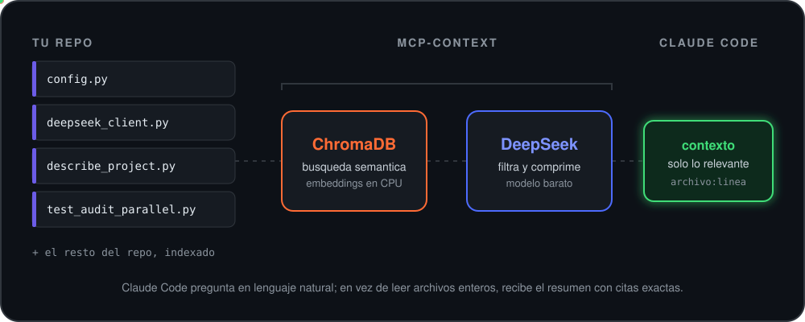
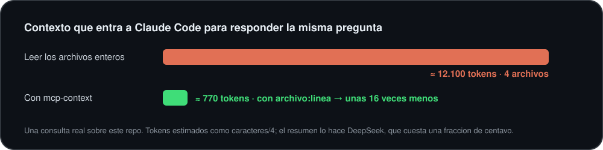
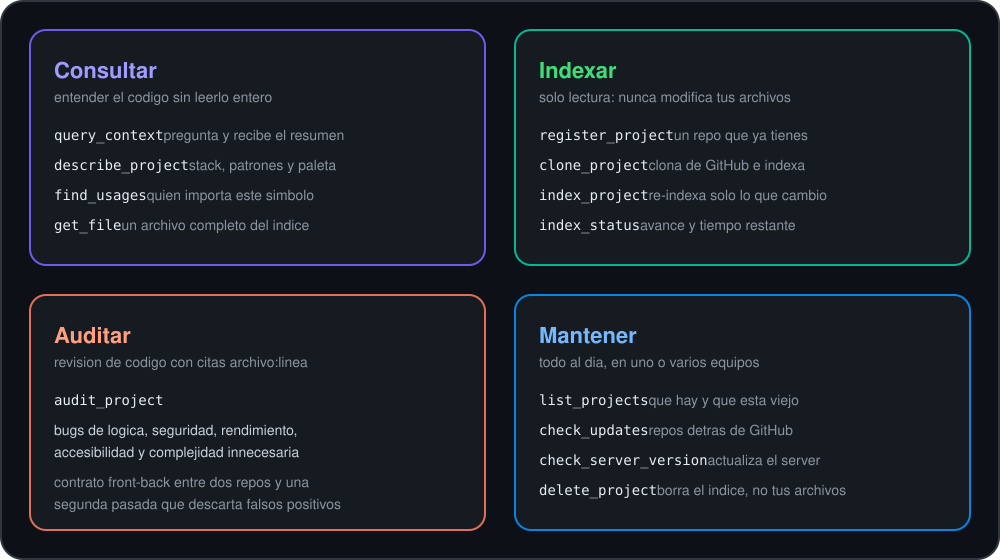

<div align="center">


### Memoria de tus proyectos para Claude Code: responde con lo relevante, no con archivos enteros.

<br/>



<br/><br/>

[](#que-puede-hacer)
[](#por-que)
[](#que-puede-hacer)
[](#instalacion)

[](https://python.org)
[](https://modelcontextprotocol.io)
[](https://platform.deepseek.com)
[](https://trychroma.com)
[](https://www.postgresql.org)
[](https://github.com/Mickaell22/mcp-context-server)

[**Por que**](#por-que) • [**Que puede hacer**](#que-puede-hacer) • [**Instalacion**](#instalacion) • [**Documentacion**](#documentacion) • [**Dashboard**](https://ia.novamicktools.com)

</div>

---

## Por que

Cuando Claude Code necesita entender una parte del proyecto, lee archivos completos y cada linea cuenta como contexto. mcp-context indexa el repo una vez, busca los fragmentos que importan y le pasa a Claude Code **un resumen con las lineas exactas** donde mirar.

<p align="center">
  
</p>

El resumen lo hace un modelo barato (DeepSeek Flash): una consulta cuesta una fraccion de centavo y una auditoria completa ronda los 1-2 centavos.

---

## Que puede hacer

<p align="center">
  
</p>

Parametros y detalle de cada una en **[docs/TOOLS.md](docs/TOOLS.md)**.

---

## Instalacion

Lo mas facil es que lo instale Claude Code. Abre Claude Code en la carpeta del repo y pidele:

```text
Lee docs/INSTALACION.md e instala mcp-context-server
```

Te va a preguntar como lo vas a usar y elige el modo:

<table>
<tr>
<td width="50%" valign="top">

### Un solo equipo

**Modo local.** La base de datos corre en tu propio equipo (Docker o la Postgres del sistema) y nada sale de el, salvo las llamadas a DeepSeek y los `git fetch` a GitHub.

Recomendado para empezar.

</td>
<td width="50%" valign="top">

### Varios equipos

**Modo multi-equipo.** Todos apuntan a la misma Postgres (Railway, Neon, Supabase o un server tuyo por Tailscale) y comparten proyectos, historial e indice de imports.

Se puede pasar de local a multi-equipo despues, sin perder nada.

</td>
</tr>
</table>

Necesitas Python 3.11+, git y una API key de [DeepSeek](https://platform.deepseek.com). Los pasos a mano estan en la misma [guia de instalacion](docs/INSTALACION.md).

---

## Documentacion

<table>
<tr>
<td width="50%" valign="top">

**[Instalacion](docs/INSTALACION.md)**<br/>
Los dos modos paso a paso, registro en Claude Code y verificacion.

</td>
<td width="50%" valign="top">

**[Tools](docs/TOOLS.md)**<br/>
Las 13 tools con todos sus parametros.

</td>
</tr>
<tr>
<td valign="top">

**[Configuracion](docs/CONFIGURACION.md)**<br/>
Variables de entorno y costos de DeepSeek por franja horaria.

</td>
<td valign="top">

**[Varios equipos](docs/MULTI-EQUIPO.md)**<br/>
Que se comparte, rutas por dispositivo y como mantener todos al dia.

</td>
</tr>
<tr>
<td valign="top" colspan="2">

**[Desarrollo](docs/DESARROLLO.md)**<br/>
Estructura del codigo, stack, tests y evaluacion del audit con bugs sembrados.

</td>
</tr>
</table>

---

## Seguridad

- **Solo lectura sobre tus proyectos.** Indexar y auditar leen los archivos en su sitio; el server solo escribe en la carpeta donde clona repos.
- **Nunca indexa secretos.** Ignora `.env`, llaves y certificados, lockfiles, minificados y todo lo que diga tu `.gitignore`.
- **Solo ejecuta git** (y `pip`, al actualizarse a si mismo si cambiaron sus dependencias). El token de GitHub viaja en memoria y nunca queda escrito en `.git/config`.
- **No se expone a internet.** Corre como proceso local de Claude Code; para varios equipos, por Tailscale.
